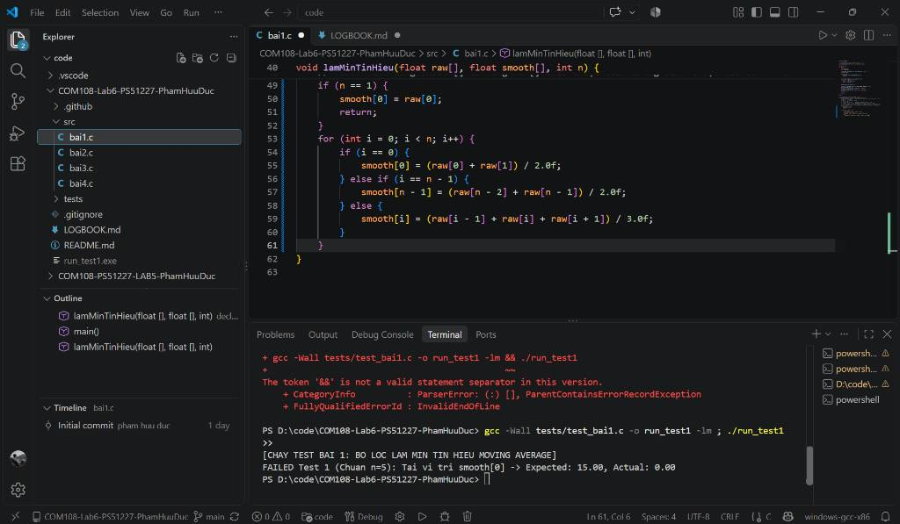
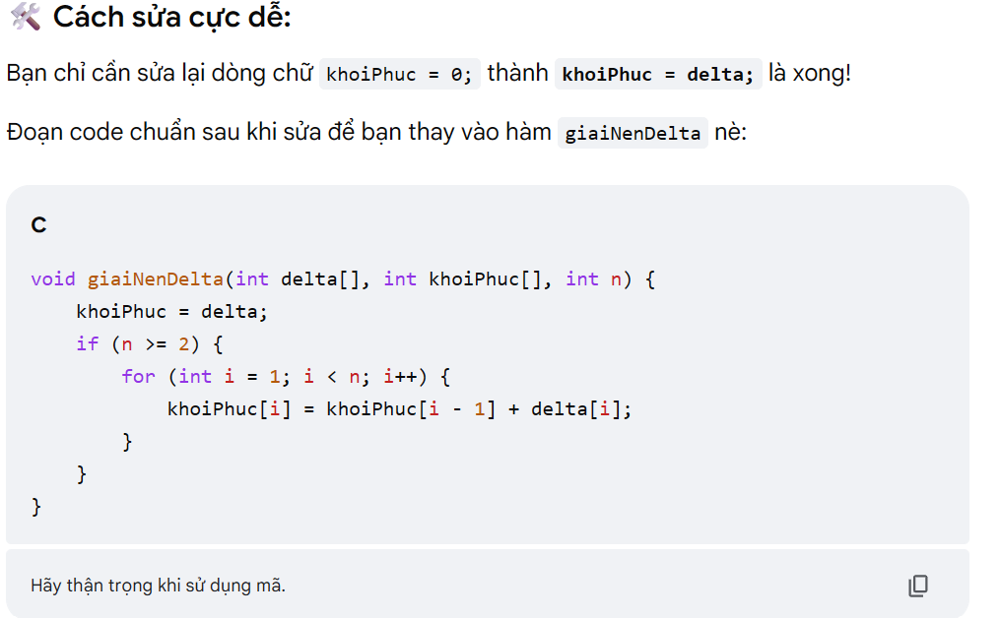

# NHẬT KÝ THỰC HIỆN LAB 6 (LOGBOOK)

* **Họ và tên:** Phạm Hữu Đức
* **Mã sinh viên:** PS51227
* **Link Repository cá nhân:** 

> [!NOTE]
> **HƯỚNG DẪN DÀNH CHO KỶ NGUYÊN AI:**  
> Bạn được khuyến khích sử dụng AI (Cursor, Copilot, ChatGPT, Claude) như một trợ lý lập trình. Tuy nhiên, AI thường xuyên sinh mã lỗi đối với các trường hợp biên (biên mảng, số âm, tràn chỉ số). Hãy ghi lại trung thực quá trình bạn phát hiện và khắc phục lỗi của AI.

---

### Lần 1: Bài 1 - Bộ Lọc Làm Mịn Tín Hiệu (Moving Average)
- Trạng thái: failed
- Prompt hỏi AI (nếu có): "sao code ban no bao loi that bai vay"
- Lỗi phát hiện qua Test (nếu có): 
- Cách sửa / Bài học: 
[CHAY TEST BAI 1: BO LOC LAM MIN TIN HIEU MOVING AVERAGE]
FAILED Test 1 (Chuan n=5): Tai vi tri smooth[0] -> Expected: 15.00, Actual: 0.00

### Lần 2: Bài 1
- Trạng thái: Pass 100%
- Lỗi / Cách sửa: 
 em viết thiếu khúc smooth[0] = raw[0]; thay vì if (n >= 2) mà em bỏ viết nó thành rertun
[CHAY TEST BAI 1: BO LOC LAM MIN TIN HIEU MOVING AVERAGE]
>>> BAI 1: PASS 100% TEST CASES!

### Lần 3: Bài 1 (Dự phòng)
- Trạng thái: 
- Lỗi / Cách sửa: 

---

### Lần 4: Bài 2 - Nén Sai Phân Dữ Liệu IoT (Delta Encoding)
- Trạng thái: failed
- Prompt hỏi AI (nếu có): 
- Lỗi phát hiện qua Test (nếu có): 
- Cách sửa / Bài học: [CHAY TEST BAI 2: NEN & GIAI NEN SAI PHAN DELTA ENCODING]
FAILED Test Nen 1: delta[0] -> Expected: 100, Actual: 0

### Lần 5: Bài 2
- Trạng thái: failed
- Lỗi / Cách sửa: [CHAY TEST BAI 2: NEN & GIAI NEN SAI PHAN DELTA ENCODING]
FAILED Test Nen 1: delta[0] -> Expected: 100, Actual: 0

### Lần 6: Bài 2 (Dự phòng)
- Trạng thái: 
- Lỗi / Cách sửa: 

---

### Lần 7: Bài 3 - Bộ Lọc Làm Mờ Điểm Ảnh (Box Blur Filter 3x3)
- Trạng thái: 
- Prompt hỏi AI (nếu có): 
- Lỗi phát hiện qua Test (nếu có): 
- Cách sửa / Bài học: 

### Lần 8: Bài 3
- Trạng thái: 
- Lỗi / Cách sửa: 

### Lần 9: Bài 3 (Dự phòng)
- Trạng thái: 
- Lỗi / Cách sửa: 

---

### Lần 10: Bài 4 - Radar Dò Điểm Nóng (Thermal Peak Detection)
- Trạng thái: 
- Prompt hỏi AI (nếu có): 
- Lỗi phát hiện qua Test (nếu có): 
- Cách sửa / Bài học: 

### Lần 11: Bài 4
- Trạng thái: 
- Lỗi / Cách sửa: 

### Lần 12: Bài 4
- Trạng thái: 
- Lỗi / Cách sửa: 

### Lần 13: Bài 4 (Dự phòng)
- Trạng thái: 
- Lỗi / Cách sửa: 
